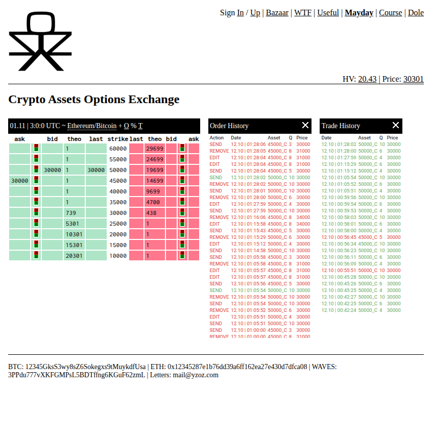

# YZoZ Option Exchange

Демонстрационная (α-версия) криптобиржа **опционов** на пару **ETH/BTC**.
Не реальные деньги: после регистрации пользователь получает виртуальные
**1000 Wei** и **100 000 000 Satoshi**, выставляет лимитные заявки на Call/Put,
система автоматически сводит встречные заявки, ведёт позиции (контракты) и
считает P/L. Теоретическая цена опциона считается по модели Блэк–Шоулза,
рыночная цена/волатильность тянутся с публичного API Bybit.

Проект — оживлённый прототип 2017–2018 гг.: воспроизводимо запускается одной
командой, зависимости зафиксированы, секреты вынесены в `.env`.



## Компоненты

```text
                     Браузер (views/*.pug + public/javascripts/*)
                                    │ HTTP — страницы
                                    │ AJAX/JSON — торговля
              ┌─────────────────────┴─────────────────────┐
              ▼                                           ▼
      Node/Express  :3000                        Python/Bottle API  :6969
      routes/*.js, views/*.pug                   api/app.py, api/inc/*
      (страницы, статика, инжект API_URL)        (REST: /signup /user /order ...)
              │ читает                                    │
              ▼                                            ▼
      exchange/instruments.json            MongoDB   InfluxDB   Memcached
      (тикеры/серии/страйки)               users/    river      PRICE/HV/
                                           orders/   заявок/     THEO/BEST/
                                           contracts сделок      LAST/STATE
                                               ▲         ▲           ▲
                                               └─────────┴───────────┘
                                                         │
                                              api/theo.py — планировщик
                                              (PRICE/THEO 1 мин, HV 15 мин)
                                              + api/utils/robo.py — графики
```

| Слой | Технологии |
|---|---|
| Веб-фронтенд | Node.js, Express 4, Pug, jQuery 3.7 / jQuery UI 1.13, LESS |
| Качество кода | ESLint + Prettier (JS), ruff (Python), `.editorconfig` |
| API | Python 3, Bottle (dev-сервер или WSGI/Gunicorn) |
| Состояние | MongoDB — `users`, `orders`, `contracts` |
| История | InfluxDB 1.8 — «river» заявок/сделок (БД `orders`, `trades`, `spot`) |
| Кэш/цены | Memcached — `PRICE/HV/THEO/BEST/LAST/STATE` |
| Планировщик | `api/theo.py` — отдельный сервис (`schedule`) |

## Формат asset-строки

Полный идентификатор опциона — строка через `_`:

```
TICKER   _  EXP          _  STRIKE  _  TYPE
ETH_BTC  _  1793491200   _  50000   _  C
   │            │              │        └─ C = Call, P = Put
   │            │              └─ страйк (в Satoshi)
   │            └─ unix-время экспирации серии (сек)
   └─ база_котируемая (base_unit)
```

Пример: `ETH_BTC_1793491200_50000_C`. Разбор — `api/inc/utils.py:splitAsset()`.

## Запуск

Требуется Node.js ≥16, Python 3.8–3.11 (проверено на 3.10), Docker.

```bash
cp .env.example .env          # конфиг: порты, креды, API_URL (см. ниже)
make up                       # хранилища (docker compose) + API + theo + веб
make e2e                      # сквозной сценарий (регистрация → ордер → сделка)
make lint                     # линтеры: ruff (Python) + ESLint (JS)
```

После старта:

- веб — <http://localhost:3000/exchange/>
- API — <http://localhost:6969/health>
- healthcheck'и — API `/health` (хранилища) и веб `/health` (веб → API); оба всегда `200`, статус в поле `status`
- остановка — `make down` (хранилища — `docker compose stop`)

> `make help` — список всех целей. Без `make` то же самое — пошагово в
> `docs/RUNBOOK.md`. Весь стек в контейнерах: `make docker-up`.

## Конфигурация (`.env.example`)

Все параметры — в `.env` (см. `.env.example`, копируется в `.env`; в git не
попадает). Основное:

- **веб:** `WEB_PORT`, `API_URL` (адрес API **для браузера**, инжектится в
  страницу), `CORS_ORIGIN`;
- **API:** `PY_MODE` (`dev` — встроенный сервер / иначе WSGI), `API_HOST`,
  `API_PORT`, `ADMIN_TOKEN`;
- **хранилища:** `MONGO_*`, `INFLUX_*`, `MEMCACHED_*` (плюс таймауты
  `MONGO_SELECT_TIMEOUT`, `INFLUX_TIMEOUT`, `STORAGE_PROBE_TTL` для
  graceful-режима);
- **rate-limit:** `RATE_LIMIT`, `RATE_WINDOW`, `RATE_MAX`.

> Главный подводный камень: `API_URL` и `API_PORT` должны совпадать, иначе сайт
> откроется, но данные будут пустыми. При недоступном хранилище API поднимается в
> **degraded**-режиме, а запросы к нему отвечают понятным `503` — см. `GET /health`.

## Разработка

```bash
make check      # синтаксис: py_compile + node --check + compose config
make lint       # ruff (Python) + ESLint (JS)
make format     # prettier --write + ruff --fix
```

Линтеры настроены в `ruff.toml`, `.eslintrc.json`, `.prettierrc.json`,
`.editorconfig`. Python-линтер `ruff` ставится отдельно (`pip install ruff`);
ESLint/Prettier — в `devDependencies` (ставятся `npm install`).

## Документация

- `docs/RUNBOOK.md` — как поднять проект с нуля (с подводными камнями и
  типовыми ошибками).
- `docs/DEVELOPER_GUIDE.md` — архитектура, доменная модель, HTTP-интерфейсы.
- `docs/SPEC.md` — техническое задание и приоритеты.
- `docs/DONE.md` — журнал выполненных работ (читать перед началом).

## Лицензия

MIT (файл `LICENCE`).
